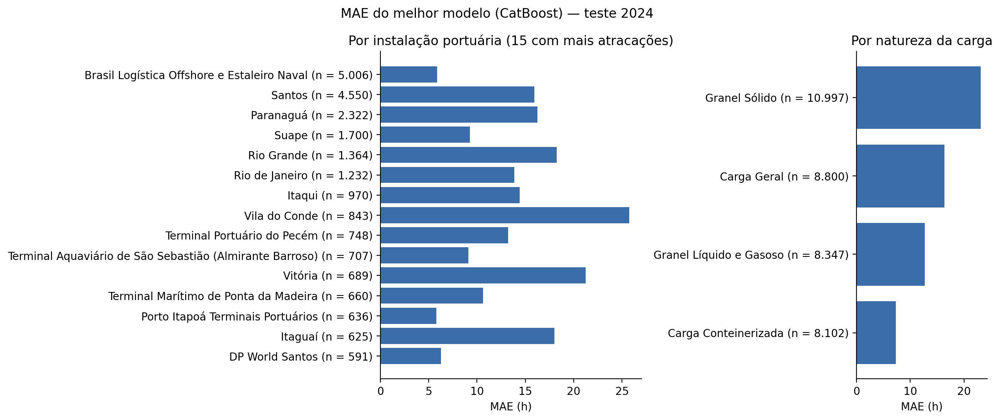

# Predição do tempo atracado de navios em portos brasileiros: análise comparativa de algoritmos de Machine Learning

**Carlos Guilherme Bittencourt Lima Paranhos** e **Renata de Souza Silva**
Bacharelado em Ciência da Computação — Centro Universitário Jorge Amado (UNIJORGE), Salvador – BA, 2026

Código, dados derivados e resultados do Trabalho de Conclusão de Curso que compara Regressão Ridge, Random Forest, XGBoost e CatBoost na predição do **tempo atracado (TA)** de navios em portos brasileiros, a partir dos dados abertos do Estatístico Aquaviário da ANTAQ. Os modelos são treinados com as atracações de 2022–2023 e avaliados nas de 2024.

## Resultados

Conjunto de teste: 36.246 atracações de 2024. Os valores abaixo saem de [`resultados/`](resultados/) e correspondem às Tabelas 2 e 3 do artigo.

| Modelo | MAE (h) | RMSE (h) | R² | Redução do MAE vs. referência |
|---|---:|---:|---:|---:|
| **CatBoost** | **15,55** | **36,46** | **0,552** | **21,5%** |
| Random Forest | 16,03 | 37,49 | 0,527 | 19,1% |
| XGBoost | 16,18 | 37,40 | 0,529 | 18,3% |
| Regressão Ridge | 17,47 | 39,52 | 0,474 | 11,8% |
| Referência ingênua (mediana por berço e tipo de carga) | 19,81 | 42,39 | 0,395 | — |

- A vantagem do CatBoost é estatisticamente significativa sobre todos os demais modelos (bootstrap pareado, IC 95%), mas as diferenças entre os *ensembles* são pequenas: 0,63 h entre o primeiro e o último.
- **O ganho depende dos atributos de volume, conhecidos só ao término da operação.** Sem peso bruto e TEU, a redução sobre a referência cai para 5,3%; sem também o número de registros de carga, para 1,0%. Em uso real, o desempenho esperado fica entre 15,55 h e 18,76 h, conforme a precisão da estimativa de volume do manifesto de carga.
- O perfil operacional obtido por K-Means (k = 4, silhueta 0,67) não trouxe ganho relevante: menos de 5 minutos por atracação.
- Entre as 15 instalações de maior movimento, o MAE vai de 5,8 h (Porto Itapoá) a 25,8 h (Vila do Conde). O SHAP aponta o peso bruto e o berço como atributos mais influentes.



## Método, em resumo

- **Dados:** bases de Atracação e Carga da ANTAQ, navegações de longo curso e cabotagem. O TA, em horas, é a diferença entre a data de desatracação e a data de atracação.
- **Atributos:** instalação portuária, berço, tipo de navegação, natureza predominante da carga, nacionalidade do armador, mês, peso bruto, TEU e nº de registros de carga (os três últimos em log).
- **Divisão temporal:** treino em 2022–2023 e teste em 2024. O corte de extremos (quantil 99,5% do TA) é calculado e aplicado **só no treino**; o teste é avaliado completo.
- **Referência ingênua:** mediana histórica do TA em cascata (berço × carga → berço → instalação → geral).
- **Perfil operacional:** K-Means sobre o volume e a composição da carga, com k escolhido pela silhueta; entra como atributo adicional.
- **Modelos:** CatBoost, Random Forest, XGBoost e Ridge, com e sem o perfil. Alvo em log(1 + TA), busca aleatória de hiperparâmetros com validação temporal (`TimeSeriesSplit`) minimizando o MAE em horas.
- **Avaliação:** MAE, RMSE e R²; bootstrap pareado (IC 95%) entre todos os pares de modelos; ablação sem os atributos de volume; erro por instalação, natureza da carga, mês e berços sem histórico; importância por SHAP.

## Estrutura

```
├── src/tempo_atracado/
│   ├── config.py            parâmetros do experimento (valores padrão = versão do artigo)
│   ├── dados.py             localização, leitura e integração das bases da ANTAQ; filtros e divisão
│   ├── referencia.py        referência ingênua em cascata
│   ├── perfil.py            perfil operacional por K-Means
│   ├── modelos.py           definição, busca de hiperparâmetros e cache dos modelos
│   ├── avaliacao.py         tabelas, bootstrap pareado, erro desagregado e figuras
│   ├── explicabilidade.py   SHAP
│   ├── pipeline.py          orquestra as etapas e gera o resumo para o artigo
│   └── __main__.py          linha de comando
├── notebooks/executar_no_colab.ipynb
├── resultados/              tabelas, figuras e resumo da execução final do trabalho
├── tests/                   teste de ponta a ponta com dados sintéticos
└── dados/                   onde ficam os arquivos da ANTAQ (fora do Git)
```

## Dados

Baixe no [Estatístico Aquaviário da ANTAQ](https://web3.antaq.gov.br/ea/sense/download.html), para 2022, 2023 e 2024, os arquivos de **Atracação** e **Carga**, e coloque os `.zip` (ou os `.txt` extraídos) em `dados/`. Detalhes em [`dados/README.md`](dados/README.md).

Os dados não vão para o repositório: são públicos e somam alguns gigabytes.

## Como rodar

### No Google Colab

Abra [`notebooks/executar_no_colab.ipynb`](notebooks/executar_no_colab.ipynb) no Colab, troque `SEU_USUARIO` pelo seu usuário do GitHub, envie os `.zip` da ANTAQ pela barra lateral e execute tudo. Com o Google Drive montado, resultados e modelos ficam em `MyDrive/tcc_tempo_atracado/resultados` e são reaproveitados se a sessão cair.

### Localmente

```bash
git clone https://github.com/SEU_USUARIO/tempo-atracado-portos.git
cd tempo-atracado-portos
python -m venv .venv && source .venv/bin/activate      # Windows: .venv\Scripts\activate
pip install -e .
# coloque os arquivos da ANTAQ em dados/
python -m tempo_atracado
```

Opções úteis:

```bash
python -m tempo_atracado --help
python -m tempo_atracado --modelos CatBoost Ridge        # treina só alguns modelos
python -m tempo_atracado --k 4                           # fixa o nº de perfis do K-Means
python -m tempo_atracado --origem-ta antaq               # TA pela coluna TAtracado (exige TemposAtracacao)
python -m tempo_atracado --corte-no-teste                # aplica o corte de extremos também ao teste
python -m tempo_atracado --xgb-nativo --sementes         # experimentos complementares
python -m tempo_atracado --dados /outro/lugar --saida /outro/resultado
```

Ou, em Python:

```python
from tempo_atracado import Config, executar
resumo = executar(Config(n_iter=15, k_fixo=None))
```

A execução completa leva de dezenas de minutos a algumas horas, conforme a máquina; a maior parte é a busca de hiperparâmetros.

## Saídas

Tudo vai para `resultados/`. O repositório já traz os resultados da execução final do trabalho, sem os modelos treinados (`.joblib`), que passam de 1 GB e podem ser regerados.

| Arquivo | Conteúdo |
|---|---|
| `resumo_para_artigo.json` | todos os valores citados no texto (funil, métricas, bootstrap, ablação, viés…) |
| `funil_preparacao.csv` | registros em cada etapa da preparação |
| `descritivas_ta.csv`, `atracacoes_por_ano_e_carga.csv` | descrição da base |
| `tabela_resultados_teste_completo.csv` | MAE, RMSE e R² de todos os modelos no teste de 2024 |
| `tabela_resultados_teste_truncado.csv` | o mesmo, só com as atracações abaixo do corte (mostra o efeito de aplicar o corte também ao teste) |
| `bootstrap_pareado_todos_os_pares.csv` | diferença de MAE e IC 95% entre todos os pares |
| `ablacao_volume.csv` | melhor modelo sem peso/TEU e sem nº de registros |
| `mae_por_*.csv`, `mae_berco_novo.csv` | erro desagregado |
| `shap_importancia.csv` | importância dos atributos |
| `perfis_kmeans.csv`, `cascata_referencia.csv`, `efeito_perfil_kmeans.csv` | diagnósticos |
| `fig_*.png` | figuras do artigo |
| `predicoes_teste.csv` | predição de cada modelo para cada atracação de 2024 |
| `modelo_streamlit.joblib` | melhor modelo e metadados para a aplicação de demonstração |
| `execucao.json` | configuração e versões das bibliotecas usadas (gerado a partir desta versão do código) |
| `modelos/` | modelos treinados (cache) |

## Reaproveitamento de modelos

Cada modelo treinado é salvo em `resultados/modelos/` com uma assinatura da configuração (anos, corte, atributos, busca, semente, k e tamanho do treino). Numa nova execução, modelos com a mesma assinatura são carregados em vez de retreinados; se algo mudar, são retreinados. Modelos sem assinatura (da primeira versão em Colab) são reaproveitados como estão.

## Reprodutibilidade

A semente padrão é 42. Os resultados podem variar ligeiramente entre versões do scikit-learn, CatBoost e XGBoost; as versões usadas em cada execução ficam em `resultados/execucao.json`.

## Testes

```bash
pip install -e ".[dev]"
pytest
```

O teste gera dados sintéticos no mesmo layout da ANTAQ e roda o pipeline inteiro com uma busca reduzida (1–3 min). Ele roda automaticamente no GitHub Actions a cada push.
