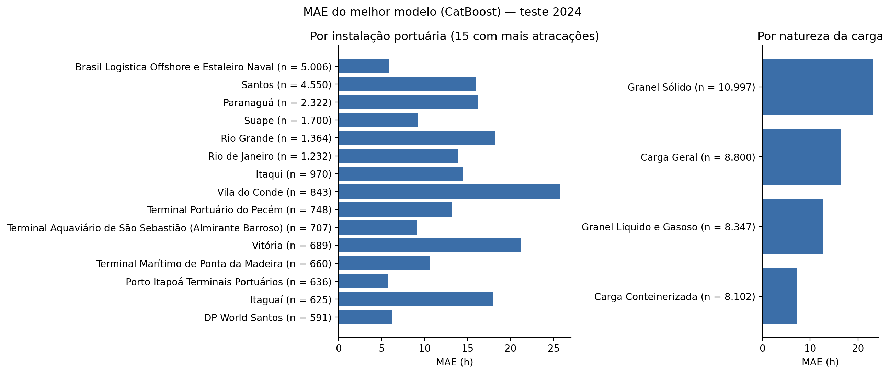

# Predição do tempo atracado de navios em portos brasileiros: análise comparativa de algoritmos de Machine Learning
 
**Carlos Guilherme Bittencourt Lima Paranhos** e **Renata de Souza Silva**
Bacharelado em Ciência da Computação — Centro Universitário Jorge Amado (UNIJORGE), Salvador – BA, 2026
 
Código, dados derivados e resultados do Trabalho de Conclusão de Curso que compara Regressão Ridge, Random Forest, XGBoost e CatBoost na predição do **tempo atracado (TA)** de navios em portos brasileiros, a partir dos dados abertos do Estatístico Aquaviário da ANTAQ. Os modelos são treinados com as atracações de 2022–2023 e avaliados nas de 2024.
 
## Resultados
 
Conjunto final: 101.617 atracações, em 132 instalações e 471 berços — 65.371 no treino (2022–2023) e 36.246 no teste (2024). Os valores abaixo saem de [`resultados/`](resultados/) e correspondem às Tabelas 2 e 3 do artigo.
 
| Modelo | MAE (h) | RMSE (h) | R² | Redução do MAE vs. referência |
|---|---:|---:|---:|---:|
| **CatBoost** | **15,55** | **36,46** | **0,552** | **21,5%** |
| Random Forest | 16,03 | 37,49 | 0,527 | 19,1% |
| XGBoost | 16,18 | 37,40 | 0,529 | 18,3% |
| Regressão Ridge | 17,47 | 39,52 | 0,474 | 11,8% |
| Referência ingênua (mediana por berço e tipo de carga) | 19,81 | 42,39 | 0,395 | — |
 
- A vantagem do CatBoost é estatisticamente significativa sobre todos os demais modelos (bootstrap pareado, IC 95%), mas as diferenças entre os *ensembles* são pequenas: 0,63 h entre o primeiro e o último.
- **O ganho depende dos atributos de volume, conhecidos só ao término da operação** — ver [Disponibilidade dos atributos](#disponibilidade-dos-atributos-e-origem-do-ganho) abaixo.
- O perfil operacional obtido por K-Means (k = 4, silhueta 0,67) não trouxe ganho relevante: menos de 5 minutos por atracação.
- Entre as 15 instalações de maior movimento, o MAE vai de 5,8 h (Porto Itapoá) a 25,8 h (Vila do Conde). O SHAP aponta o peso bruto e o berço como atributos mais influentes.

 
## Disponibilidade dos atributos e origem do ganho
 
O cenário considerado é a estimativa do TA **antes da atracação**, para apoio à programação dos berços, usando apenas a base pública da ANTAQ. O trabalho não tem acesso a informações internas dos terminais, como o manifesto de carga, e não pressupõe sua existência. Sob esse critério os atributos se dividem em dois grupos:
 
| Grupo | Atributos | Disponível antes da atracação |
|---|---|---|
| Estruturais | instalação portuária, berço, tipo de navegação, mês, nacionalidade do armador | sim |
| Derivados da carga movimentada | peso bruto, TEU, nº de registros de carga, natureza da carga, perfil K-Means | não — só existem ao término da operação |
 
A ablação retreina os quatro modelos sem os atributos de volume, mantendo os hiperparâmetros do modelo completo. MAE no teste de 2024, com a redução sobre a referência ingênua (19,81 h) entre parênteses:
 
| Modelo | Completo | Sem peso e TEU | Sem peso, TEU e nº de registros |
|---|---:|---:|---:|
| CatBoost | 15,55 h (21,5%) | 18,76 h (5,3%) | 19,62 h (1,0%) |
| Random Forest | 16,03 h (19,1%) | 19,07 h (3,8%) | 20,13 h (−1,6%) |
| XGBoost | 16,18 h (18,3%) | 19,42 h (2,0%) | 20,37 h (−2,8%) |
| Regressão Ridge | 17,47 h (11,8%) | 19,67 h (0,7%) | 20,10 h (−1,4%) |
 
Valores negativos indicam erro superior ao da referência. Das 4,27 h de vantagem do CatBoost completo, 3,21 h vêm de atributos que, na base pública, só existem após a operação. Retirado também o número de registros de carga, apenas o CatBoost ainda supera a referência, por 0,19 h. Com a informação estrutural disponível antes da atracação, os algoritmos avaliados **pouco acrescentam ao histórico operacional**.
 
Mesmo a variante mais restrita mantém a natureza da carga, também derivada dos registros de carga — atributo empregado igualmente pela referência ingênua, de modo que a comparação permanece em condições equivalentes.
 
> **Hipótese não verificada.** Caso o operador disponha de uma estimativa prévia de quantidade, como a do manifesto de carga, é razoável supor um desempenho intermediário entre o do modelo completo (15,55 h) e o das variantes sem volume (18,76 a 19,62 h). Essa suposição **não foi testada**: depende da existência e da precisão dessa estimativa, informação ausente da base pública e inacessível a este estudo. Os resultados deste repositório não a sustentam.
 
As conclusões da ablação valem para os quatro algoritmos **na configuração avaliada**, com os hiperparâmetros ajustados sobre o modelo completo e sem nova busca nas variantes. Repetir a busca em cada variante pode alterar as magnitudes.
 
## Como ler as saídas do modelo
 
**Reconversão da escala logarítmica.** O alvo é `log(1 + TA)` e os modelos são ajustados com perda quadrática nessa escala, isto é, estimam a *média condicional do logaritmo*. A reconversão por `expm1` **não devolve a média condicional do TA em horas**, por efeito do viés de Jensen, e **só coincide com a mediana condicional se os resíduos em escala logarítmica forem simétricos**. Essa condição não é assumida: é verificada empiricamente em `resultados/parecer/diagnostico_mediana.csv`. No teste de 2024 o CatBoost apresentou mediana do resíduo em log de −0,02, assimetria de 0,21 e 47,6% das atracações acima do valor previsto, proporção que varia entre 43% e 53% nos decis da predição. A predição é tratada, portanto, como **aproximação da mediana condicional** — coerente com o uso do MAE como métrica principal, que é minimizada pela mediana —, e não como garantia.
 
**Valores SHAP.** Os valores em `resultados/shap_importancia.csv` são contribuições aditivas **na escala logarítmica**. A coluna de média de |SHAP| é uma magnitude típica, sem sinal, e **não se converte em efeito percentual sobre o tempo atracado**. A coluna de participação indica quanto cada atributo representa da soma das importâncias, não quanto altera o TA. Para uma atracação específica, uma contribuição φ multiplica o `(1 + TA)` previsto por `exp(φ)` em relação ao valor-base do modelo. Nos atributos categóricos, as cores da figura refletem a codificação interna das categorias e **não admitem leitura de ordem**.
 
Importâncias do CatBoost (média |SHAP| em log; participação na soma): peso bruto 0,333 (32,3%), berço 0,265 (25,7%), natureza da carga 0,168 (16,3%), instalação portuária 0,090 (8,8%); os demais somam 16,9%.
 
## Estrutura do erro e utilidade operacional
 
O MAE agregado esconde a dispersão do erro. O CatBoost apresenta viés médio de −4,53 h, isto é, **subestima** o tempo atracado, e o viés muda de sinal ao longo da distribuição:
 
| TA observado | % do teste | MAE (h) | Viés (h) | Dentro de ±12 h |
|---|---:|---:|---:|---:|
| até 12 h | 16,7% | 4,3 | +3,5 | 94% |
| 12–24 h | 21,2% | 5,8 | +1,9 | 90% |
| 24–48 h | 27,9% | 10,1 | +2,9 | 70% |
| 48–120 h | 26,4% | 18,9 | −3,2 | 42% |
| acima de 120 h | 7,7% | 75,0 | −70,7 | 11% |
 
As atracações acima de 120 h são 7,7% do teste e concentram 37,3% da soma dos erros absolutos. No conjunto, 66,3% das predições ficam dentro de ±12 h e 83,7% dentro de ±24 h, contra 59,1% e 77,3% da referência ingênua.
 
O modelo é informativo para a programação de atracações curtas e médias — até 48 h, que somam 65,9% do teste, 82,5% das predições ficam dentro de ±12 h —, mas **não identifica antecipadamente as estadias longas**, justamente as de maior impacto sobre a ocupação dos berços. Para essas, uma estimativa pontual é inadequada; intervalos de previsão seriam mais úteis.
 
**Sensibilidade ao corte de extremos.** O corte do quantil 99,5% (348,4 h) é aplicado só ao treino; o teste é avaliado completo. Retreinando o CatBoost com outros cortes: sem corte, o MAE sobe para 16,23 h (+0,68 h; IC 95%: 0,56 a 0,80 h); com o quantil de 99,9% (737,0 h), para 15,75 h (+0,20 h; IC 95%: 0,13 a 0,28 h); com o de 99% (272,8 h), a diferença não é significativa (−0,03 h; IC 95%: −0,08 a 0,02 h). Acima de 120 h o efeito é pequeno em qualquer configuração: o MAE varia entre 72,4 e 78,3 h. **A subestimação das atracações longas não decorre do corte**, mas da ausência, na base, de informação que permita antecipá-las.
 
## Método, em resumo
 
- **Dados:** bases de Atracação e Carga da ANTAQ, navegações de longo curso e cabotagem. O TA, em horas, é a diferença entre a data de desatracação e a data de atracação.
- **Atributos:** instalação portuária, berço, tipo de navegação, natureza predominante da carga, nacionalidade do armador, mês, peso bruto, TEU e nº de registros de carga (os três últimos em log). A disponibilidade de cada grupo no momento da previsão está em [Disponibilidade dos atributos](#disponibilidade-dos-atributos-e-origem-do-ganho).
- **Divisão temporal:** treino em 2022–2023 e teste em 2024. O corte de extremos (quantil 99,5% do TA) é calculado e aplicado **só no treino**; o teste é avaliado completo.
- **Referência ingênua:** mediana histórica do TA em cascata (berço × carga → berço → instalação → geral).
- **Perfil operacional:** K-Means sobre o volume e a composição da carga, com k escolhido pela silhueta; entra como atributo adicional.
- **Modelos:** CatBoost, Random Forest, XGBoost e Ridge, com e sem o perfil. Alvo em log(1 + TA), busca aleatória de hiperparâmetros com validação temporal (`TimeSeriesSplit`) minimizando o MAE em horas.
- **Avaliação:** MAE, RMSE e R²; bootstrap pareado (IC 95%) entre todos os pares de modelos; ablação sem os atributos de volume nos quatro modelos; sensibilidade ao corte de extremos; erro por instalação, natureza da carga, faixa de duração, mês e berços sem histórico; importância por SHAP.
## Estrutura
 
```
├── src/tempo_atracado/
│   ├── config.py            parâmetros do experimento (valores padrão = versão do artigo)
│   ├── dados.py             localização, leitura e integração das bases da ANTAQ; filtros e divisão
│   ├── referencia.py        referência ingênua em cascata
│   ├── perfil.py            perfil operacional por K-Means
│   ├── modelos.py           definição, busca de hiperparâmetros e cache dos modelos
│   ├── avaliacao.py         tabelas, bootstrap pareado, erro desagregado e figuras
│   ├── explicabilidade.py   SHAP
│   ├── pipeline.py          orquestra as etapas e gera o resumo para o artigo
│   └── __main__.py          linha de comando
├── app/                     protótipo em Streamlit (app.py = interface, nucleo.py = predição)
├── notebooks/               executar_no_colab.ipynb (experimento) e gerar_modelo_no_colab.ipynb (modelo do protótipo)
├── resultados/              tabelas, figuras e resumo da execução final do trabalho
├── tests/                   teste de ponta a ponta com dados sintéticos
└── dados/                   onde ficam os arquivos da ANTAQ (fora do Git)
```
 
## Dados
 
Os arquivos de **Atracação** e **Carga** de 2022, 2023 e 2024 usados no trabalho (base de dados do Estatístico Aquaviário da ANTAQ) estão na [Release v1.0](../../releases) do repositório, já que o endereço original do painel (`web3.antaq.gov.br`) saiu do ar. Baixe os seis `.zip` e coloque-os (ou os `.txt` extraídos) em `dados/`. Detalhes em [`dados/README.md`](dados/README.md).
 
Os dados não vão para o repositório: são públicos e somam alguns gigabytes.
 
## Como rodar
 
### No Google Colab
 
Abra [`notebooks/executar_no_colab.ipynb`](notebooks/executar_no_colab.ipynb) no Colab, troque `SEU_USUARIO` por `Guilherme-Bittencourt` (ou pelo seu usuário, se tiver feito um fork), cole em `MODELOS_URL` o link do `modelos.zip` da [Release v1.0](../../releases) para reaproveitar os modelos treinados, envie os `.zip` da ANTAQ pela barra lateral, espere o upload terminar e execute tudo. Com o Google Drive montado, resultados e modelos ficam em `MyDrive/tcc_tempo_atracado/resultados` e são reaproveitados se a sessão cair.
 
### Localmente
 
```bash
git clone https://github.com/SEU_USUARIO/tempo-atracado-portos.git
cd tempo-atracado-portos
python -m venv .venv && source .venv/bin/activate      # Windows: .venv\Scripts\activate
pip install -e .
# coloque os arquivos da ANTAQ em dados/
python -m tempo_atracado
```
 
Opções úteis:
 
```bash
python -m tempo_atracado --help
python -m tempo_atracado --modelos CatBoost Ridge        # treina só alguns modelos
python -m tempo_atracado --k 4                           # fixa o nº de perfis do K-Means
python -m tempo_atracado --origem-ta antaq               # TA pela coluna TAtracado (exige TemposAtracacao)
python -m tempo_atracado --corte-no-teste                # aplica o corte de extremos também ao teste
python -m tempo_atracado --xgb-nativo --sementes         # experimentos complementares
python -m tempo_atracado --dados /outro/lugar --saida /outro/resultado
```
 
Ou, em Python:
 
```python
from tempo_atracado import Config, executar
resumo = executar(Config(n_iter=15, k_fixo=None))
```
 
A execução completa leva de dezenas de minutos a algumas horas, conforme a máquina; a maior parte é a busca de hiperparâmetros.

### Teste rápido, sem os dados da ANTAQ

Para conferir que o código roda sem baixar os arquivos da ANTAQ (alguns gigabytes), gere dados sintéticos no mesmo formato e execute o pipeline com uma busca reduzida, gravando numa pasta separada para não sobrescrever os resultados do trabalho:

```bash
pip install -e .
python tests/dados_sinteticos.py              # cria dados_sinteticos/ com os .zip no layout da ANTAQ
python -m tempo_atracado --dados dados_sinteticos --saida resultados_teste --n-iter 2 --n-bootstrap 50 --n-shap 200
```

Leva de 1 a 2 minutos. Os números obtidos não têm significado: servem apenas para verificar a execução de todas as etapas. Para ver o protótipo com esse modelo de teste: `MODELO_TA=resultados_teste/modelo_streamlit.joblib streamlit run app/app.py`.

> **Atenção:** sem `--saida`, os resultados vão para `resultados/` e substituem os da execução final do trabalho que estão versionados no repositório.

## Protótipo de apoio à decisão

Interface em Streamlit que aplica o melhor modelo a uma atracação programada, sempre ao lado da referência ingênua (mediana histórica por berço e tipo de carga), para que o ganho do modelo fique explícito.

```bash
pip install -e ".[app]"
streamlit run app/app.py
```

O protótipo lê `resultados/modelo_streamlit.joblib`, o melhor modelo da execução final do trabalho, que **já vem no repositório** (cerca de 2 MB): basta clonar e rodar. Para usar outro modelo, por exemplo um gerado pelo notebook `gerar_modelo_no_colab.ipynb`, substitua o arquivo ou aponte a variável de ambiente `MODELO_TA` para ele. As demais abas usam as tabelas de `resultados/`.

O modelo é salvo com o scikit-learn da execução que o gerou (no Colab da execução final, 1.6.1). Rode o protótipo com a mesma versão (`pip install scikit-learn==1.6.1`) para evitar avisos de incompatibilidade ao carregar o arquivo.

| Aba | Conteúdo |
|---|---|
| Predição | formulário com instalação, berço, tipo de navegação, natureza da carga, armador, mês e **estimativa prévia** de volume; devolve o TA previsto, a referência ingênua, o MAE da instalação no teste e o que aconteceu em 2024 com as atracações que receberam previsões parecidas (faixa de 80% dos tempos observados), com alerta quando essa faixa tem muitas estadias acima de 120 h |
| Lote (CSV) | aplica o modelo a uma programação de atracações e devolve as estimativas em CSV |
| Desempenho | métricas no teste de 2024, comparação entre algoritmos, ablação dos atributos de volume nos quatro modelos, erro por duração da atracação, importância por SHAP e erro por instalação |
| Sobre o modelo | cenário de uso, método, atributos e limitações |

Os valores de desempenho exibidos foram medidos com o volume **realizado**. Com uma estimativa prévia de volume, o desempenho não foi verificado (ver [Disponibilidade dos atributos](#disponibilidade-dos-atributos-e-origem-do-ganho)).

O protótipo não retreina nada: é apenas a camada de uso do modelo já avaliado. A pasta `app/` não depende de `src/tempo_atracado`, então o `.joblib`, a pasta `resultados/` e os dois arquivos do app bastam para hospedá-lo (Streamlit Community Cloud, por exemplo).
 
## Saídas
 
Tudo vai para `resultados/`. O repositório já traz os resultados da execução final do trabalho e o modelo do protótipo (`modelo_streamlit.joblib`). Os demais modelos treinados passam de 1 GB e não ficam no Git: estão no arquivo `modelos.zip` da [Release v1.0](../../releases) do repositório. Para reaproveitá-los no Colab em vez de retreinar, cole o link desse arquivo em `MODELOS_URL`, no notebook `executar_no_colab.ipynb`; os experimentos complementares (ablação nos quatro modelos e sensibilidade ao corte) são sempre retreinados e levam algumas dezenas de minutos.
 
| Arquivo | Conteúdo |
|---|---|
| `resumo_para_artigo.json` | todos os valores citados no texto (funil, métricas, bootstrap, ablação, viés…) |
| `funil_preparacao.csv` | registros em cada etapa da preparação |
| `descritivas_ta.csv`, `atracacoes_por_ano_e_carga.csv` | descrição da base |
| `tabela_resultados_teste_completo.csv` | MAE, RMSE e R² de todos os modelos no teste de 2024 |
| `tabela_resultados_teste_truncado.csv` | o mesmo, só com as atracações abaixo do corte (mostra o efeito de aplicar o corte também ao teste) |
| `bootstrap_pareado_todos_os_pares.csv` | diferença de MAE e IC 95% entre todos os pares |
| `ablacao_volume.csv` | melhor modelo sem peso/TEU e sem nº de registros |
| `utilidade_operacional.csv`, `erro_por_faixa_ta.csv` | % dentro de ±6/±12/±24 h e erro por faixa de duração |
| `mae_por_*.csv`, `mae_berco_novo.csv` | erro desagregado |
| `shap_importancia.csv` | importância dos atributos (magnitude em escala log — ver [Como ler as saídas](#como-ler-as-saídas-do-modelo)) |
| `perfis_kmeans.csv`, `cascata_referencia.csv`, `efeito_perfil_kmeans.csv` | diagnósticos |
| `fig_*.png` | figuras do artigo |
| `predicoes_teste.csv` | predição de cada modelo para cada atracação de 2024 |
| `modelo_streamlit.joblib` | melhor modelo e metadados para o [protótipo](#protótipo-de-apoio-à-decisão) |
| `execucao.json` | configuração e versões das bibliotecas usadas (gerado a partir desta versão do código) |
| `modelos/` | modelos treinados (cache) |
 
Experimentos complementares, em `resultados/parecer/`:
 
| Arquivo | Conteúdo |
|---|---|
| `ablacao_todos_os_modelos.csv` | ablação dos atributos de volume nos quatro modelos, com IC 95% por bootstrap |
| `sensibilidade_corte.csv` | CatBoost sem corte e com cortes nos quantis de 99%, 99,5% e 99,9% do treino |
| `diagnostico_mediana.csv` | resíduos na escala logarítmica: mediana, assimetria e proporção de observados acima do previsto |
| `predicoes_teste_completas.csv` | predição de cada variante para cada atracação de 2024 |
 
## Reaproveitamento de modelos
 
Cada modelo treinado é salvo em `resultados/modelos/` com uma assinatura da configuração (anos, corte, atributos, busca, semente, k e tamanho do treino). Numa nova execução, modelos com a mesma assinatura são carregados em vez de retreinados; se algo mudar, são retreinados. Modelos sem assinatura (da primeira versão em Colab) são reaproveitados como estão.
 
## Reprodutibilidade
 
A semente padrão é 42. Os resultados podem variar ligeiramente entre versões do scikit-learn, CatBoost e XGBoost; as versões usadas em cada execução ficam em `resultados/execucao.json`.
 
## Testes
 
```bash
pip install -e ".[dev]"
pytest
```
 
O teste gera dados sintéticos no mesmo layout da ANTAQ, roda o pipeline inteiro com uma busca reduzida e verifica o núcleo do protótipo com o modelo exportado (1–3 min). Ele roda automaticamente no GitHub Actions a cada push.
 
## Declaração de uso de inteligência artificial

Os autores declaram o uso de ferramentas de Inteligência Artificial generativa na elaboração deste trabalho, nos seguintes termos.

Na redação, as ferramentas foram empregadas no aprimoramento do texto, com foco na clareza, na concisão e na adequação à linguagem técnica e ao padrão de escrita acadêmica, bem como na revisão linguística e na organização da exposição dos conteúdos.

No desenvolvimento do produto, as ferramentas foram empregadas na estruturação e na escrita do código do experimento e na depuração de erros de implementação. O código resultante foi revisado pelos autores e validado por um teste automatizado, executado a cada alteração do repositório, que reproduz o fluxo completo sobre dados sintéticos.

A concepção do trabalho, a definição do problema de pesquisa, a seleção e a leitura das fontes, as decisões metodológicas, a interpretação dos resultados e a redação das conclusões foram realizadas pelos autores.

Nenhum conteúdo foi incorporado ao trabalho sem verificação. Os autores revisaram integralmente o texto final e o código do experimento, e assumem responsabilidade plena por seu conteúdo, incluindo a exatidão das informações apresentadas, a correção das referências bibliográficas e a fidelidade das afirmações às evidências obtidas.
